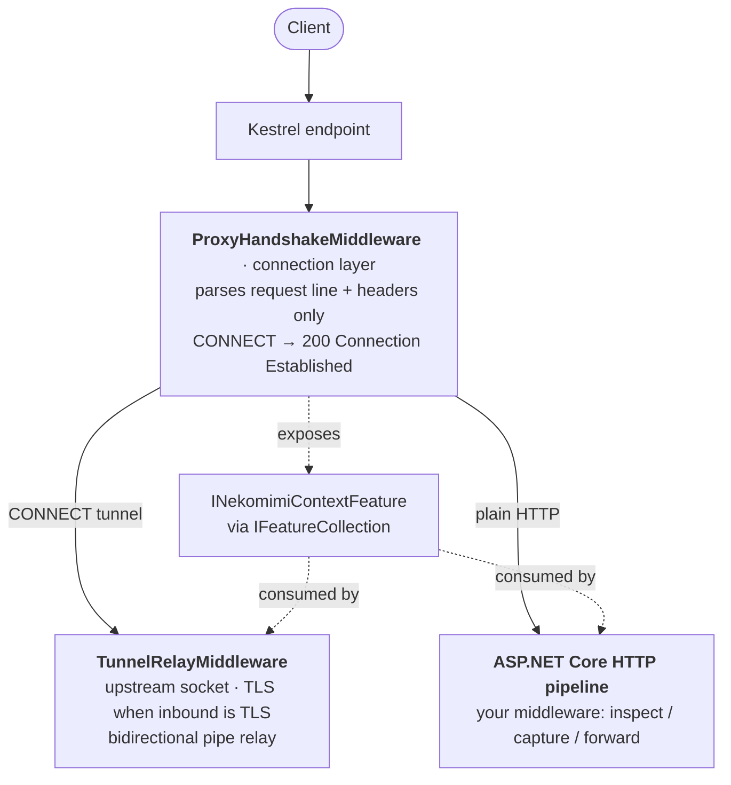

# Nekomimi

Your network traffic is being listened by a cat.

**Nekomimi** is a lightweight forward-proxy / traffic-capture library for .NET, built directly on top of Kestrel's connection layer. It lets an ASP.NET Core application accept plain HTTP requests and CONNECT tunnels, inspect every message that passes through, and relay traffic upstream — originally built as the interception engine behind ING.

## Features

- **Plain HTTP interception** — requests flow into the standard ASP.NET Core pipeline, where your middleware can read, log, modify, or forward them.
- **`CONNECT` tunneling** — full tunnel handshake (`200 Connection Established`) with bidirectional relay, TLS-aware on both the inbound and outbound side.
- **Reverse-proxy mode** — optionally pin all traffic to a fixed upstream endpoint (`NekomimiOptions.ReverseProxyEndpoint`).
- **Zero-allocation hot paths** — `System.Buffers` / `System.IO.Pipelines` throughout; no per-message byte arrays.

## Architecture



## Usage

```csharp
var builder = WebApplication.CreateSlimBuilder();

builder.WebHost.UseNekomimi((context, nekomimi) =>
{
    // Optional: pin all traffic to a fixed upstream
    // nekomimi.ReverseProxyEndpoint = new HostString("upstream.example.com");
});
builder.WebHost.ConfigureKestrel(kestrel =>
{
    kestrel.Listen(IPAddress.Loopback, 0, listenOptions =>
    {
        listenOptions.UseNekomimi();
    });
});

var app = builder.Build();

// ...

app.Run();
```

## Licence

[MIT License (MIT)](./LICENSE)